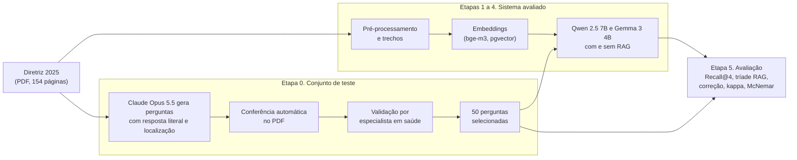
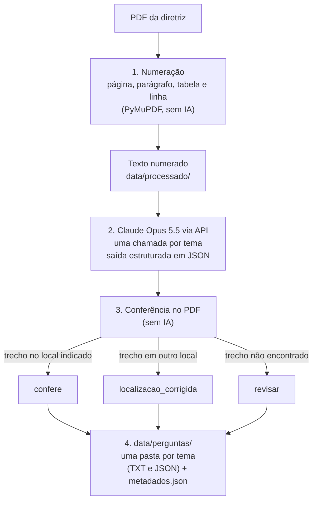

# Perguntas e respostas sobre a Diretriz Brasileira de Hipertensão Arterial 2025: o impacto do RAG em modelos de linguagem abertos

Projeto final da disciplina Tópicos Avançados em Ciência de Dados (PLN), Mestrado Profissional em Tecnologia da Informação, IFPB, período 2026.2.

- Discente: Rodrigo de Queiroz Gonçalves Velez
- Docentes: Damires Souza e Alex Cunha

## Objetivo

Medir quanto o RAG (Retrieval-Augmented Generation) melhora as respostas de dois LLMs abertos e pequenos, executados localmente, a perguntas em português sobre hipertensão. A base de conhecimento é a Diretriz Brasileira de Hipertensão Arterial 2025, publicada depois do treinamento desses modelos.

Perguntas de pesquisa:

- P1: sem RAG, quanto os modelos acertam e quanto se apoiam no critério antigo (diretriz de 2020)?
- P2: quanto o RAG aumenta a acurácia?
- P3: quando o RAG erra, a falha é da busca ou da geração?

## Visão geral do projeto



Siglas:

- RAG: Retrieval-Augmented Generation (geração aumentada por recuperação)
- LLM: Large Language Model (grande modelo de linguagem)
- MAPA: Monitorização Ambulatorial da Pressão Arterial
- MRPA: Medida Residencial da Pressão Arterial
- PAS: pressão arterial sistólica
- PAD: pressão arterial diastólica

## Etapa 0. Geração do conjunto de teste

Script principal: [src/gerar_perguntas.py](src/gerar_perguntas.py). Ele traz o passo a passo de execução e chama as etapas, que ficam em [src/geracao_perguntas/](src/geracao_perguntas/):

- [configuracao.py](src/geracao_perguntas/configuracao.py): parâmetros do experimento (modelo, esforço, temas, preços e caminhos)
- [etapa1_extracao.py](src/geracao_perguntas/etapa1_extracao.py): lê o PDF e numera página, parágrafo, tabela e linha (sem IA)
- [etapa2_geracao.py](src/geracao_perguntas/etapa2_geracao.py): pede as perguntas ao Claude pela API
- [etapa3_conferencia.py](src/geracao_perguntas/etapa3_conferencia.py): confere no PDF cada localização informada (sem IA)
- [etapa4_resultados.py](src/geracao_perguntas/etapa4_resultados.py): grava o TXT e o JSON de cada tema e o metadados.json geral

Antes da etapa 2, que chama a API, o script mostra o custo estimado e pede confirmação.

O script numera o PDF, pede ao Claude perguntas em linguagem leiga com a resposta copiada literalmente da diretriz e confere, sem IA, se cada resposta está de fato na página, no parágrafo e nas linhas indicadas.

Regras de linguagem do prompt:

- Pergunta: escrita como um paciente ou familiar sem formação em saúde falaria, sem siglas nem jargão e com valores no jeito popular ("13 por 8")
- Não citar o documento: nem a pergunta nem a resposta leiga mencionam a diretriz, tabelas, quadros, capítulos ou força de recomendação, porque o leigo não sabe que ela existe
- `resposta_referencia`: cópia literal da diretriz, de preferência de trechos que não mencionem o próprio documento. É o gabarito do juiz e a base da conferência automática
- `resposta_leiga`: a mesma informação da resposta literal em 1 a 3 frases curtas, com os mesmos números e sem acrescentar nada. Perguntas geradas antes de 16/11/2026 não têm este campo



Temas (30 perguntas cada, 150 no total, das quais pelo menos 12 sobre a nova classificação). Temas com menos perguntas que o pedido são completados, sem repetir as já existentes:

- Classificação da pressão arterial e mudanças em relação a 2020
- Diagnóstico e medição
- Metas de tratamento
- Medidas sem remédio
- Situações especiais (idosos, gestantes, crianças, diabetes, doença renal e outras)

Definição da localização:

- Página: página do arquivo PDF, começando em 1 (igual à numeração impressa no rodapé)
- Parágrafo: bloco de texto identificado pelo PyMuPDF, contado na ordem de leitura da página. Cabeçalho, rodapé, títulos de seção e tabelas não contam
- Tabela: tabela ou quadro identificado pelo PyMuPDF, com contagem própria na página (tabela 1, tabela 2...)
- Linha: num parágrafo, a linha de texto. Numa tabela, a linha da tabela (o cabeçalho é a linha 1), com as células separadas por " | "

Arquivos gerados em `data/processado/`:

- `diretriz_2025_numerado.txt`: texto numerado enviado ao Claude
- `diretriz_2025_estrutura.jsonl`: a mesma numeração em JSON Lines (um registro por título, parágrafo ou tabela), usada na conferência das localizações

A cada execução, o script confere a integridade da extração: o total de letras e números do corpo do PDF deve ser igual ao total extraído. Na diretriz de 2025 os dois totais são 522.356.

### Ambiente da pesquisa

Para reproduzir os resultados, use exatamente estas versões:

- Python: 3.14.7 ([página oficial da versão](https://www.python.org/downloads/release/python-3147/))
- anthropic: 2.8.0
- PyMuPDF: 2.1
- python-dotenv: 1.2.4
- Modelo: claude-opus-5-5 (Claude Opus 5.5)

As bibliotecas estão fixadas em [src/requirements.txt](src/requirements.txt). O script avisa quando é executado com outra versão do Python.

### Como executar

O passo a passo completo, pensado para quem nunca usou Python, está no início do [script](src/gerar_perguntas.py). Todos os comandos são digitados na pasta raiz do projeto.

**1. Instalar o Python 3.14.7**

- macOS: baixe e instale [python-3.14.7-macos11.pkg](https://www.python.org/ftp/python/3.14.7/python-3.14.7-macos11.pkg)
- Windows: baixe e instale [python-3.14.7-amd64.exe](https://www.python.org/ftp/python/3.14.7/python-3.14.7-amd64.exe) (processador ARM: [python-3.14.7-arm64.exe](https://www.python.org/ftp/python/3.14.7/python-3.14.7-arm64.exe)) e marque "Add python.exe to PATH"

Conferir (deve mostrar `Python 3.14.7`):

```bash
python3.14 --version          # macOS
py -3.14 --version            # Windows (PowerShell)
```

**2. Entrar na pasta raiz do projeto**

A pasta raiz é `Tarefa 10 - Projeto Final`, a que contém `src`, `docs` e `data`. Todos os comandos seguintes são digitados nela, nunca dentro de `src`. Digite `cd ` (com espaço), arraste a pasta raiz para o terminal e tecle Enter. Se estiver dentro de `src`, basta `cd ..`.

```bash
ls      # macOS: deve listar docs, src e data
dir     # Windows (PowerShell)
```

**3. Criar o ambiente virtual** (uma única vez, cria a pasta `.venv` na raiz)

```bash
python3.14 -m venv .venv          # macOS
py -3.14 -m venv .venv            # Windows (PowerShell)
```

**4. Ativar o ambiente virtual** (sempre que abrir um novo terminal, depois do passo 2)

```bash
source .venv/bin/activate     # macOS
.venv\Scripts\Activate.ps1    # Windows (PowerShell)
```

No Windows, se aparecer erro de execução de scripts desabilitada, rode uma única vez `Set-ExecutionPolicy -Scope CurrentUser RemoteSigned` e repita a ativação. Para conferir, `python --version` deve mostrar `Python 3.14.7`.

**5. Instalar as bibliotecas** (igual no macOS e no Windows, com o ambiente ativo)

```bash
python -m pip install -r src/requirements.txt
python -m pip list            # conferir as versões
```

**6. Criar a chave da API** no Claude Console ([platform.claude.com](https://platform.claude.com))

- Créditos: botão "Adicionar saldo", no canto superior direito
- Chave: menu da esquerda, seção "Organização", opção "Chaves", botão "Criar chave" e, na janela "Conectar-se à Claude API", opção "Em outro lugar"

**7. Gravar a chave no arquivo .env**

O `.env` é um arquivo de texto chamado exatamente `.env` (com ponto no início e sem extensão), na pasta raiz do projeto. Ele tem uma única linha, sem espaços em volta do `=` e sem aspas:

```
ANTHROPIC_API_KEY=sk-ant-api03-...
```

Para criar o arquivo já no formato certo e abri-lo:

```bash
echo "ANTHROPIC_API_KEY=cole_sua_chave_aqui" > .env                                   # macOS
Set-Content -Path .env -Value "ANTHROPIC_API_KEY=cole_sua_chave_aqui" -Encoding ascii  # Windows (PowerShell)

open -e .env                      # macOS
notepad .env                      # Windows
```

Troque `cole_sua_chave_aqui` pela sua chave e salve. O `.env` está no `.gitignore`, então a chave não vai para o GitHub.

**8. Executar** (igual no macOS e no Windows, com o ambiente ativo)

```bash
python src/gerar_perguntas.py
```

Outras opções:

- `--apenas-extrair`: só numera o PDF, sem usar a API
- `--qtde-por-tema N`: gera N perguntas em cada um dos 5 temas, de 1 até o máximo de 30 (padrão, definido em `PERGUNTAS_POR_TEMA`)
- `--verificar`: refaz a conferência dos temas já gerados e regrava o TXT e o JSON de cada um, sem usar a API
- `--log-prompt`: grava em cada pasta de tema um `prompt.txt` com o prompt que seria enviado ao Claude (instruções, formato de saída e pedido), sem usar a API nem pedir a chave. Toda execução que chama a API também grava esses arquivos antes da confirmação de custo

Temas que já têm o JSON gravado em `data/perguntas/` são reaproveitados sem custo. Se a execução for interrompida, basta rodar o mesmo comando de novo. Para gerar um tema de novo, apague a pasta dele.

Resultado em `data/perguntas/`:

```
data/perguntas/
├── metadados.json                 dados gerais (PDF, modelo, prompt, versões, custo)
├── 01-Classificacao/
│   ├── 01-Classificacao.txt       id, status, pergunta, resposta, resposta leiga e localização no PDF
│   ├── 01-Classificacao.json      tudo do tema, inclusive a resposta original da API
│   └── prompt.txt                 prompt enviado ao Claude neste tema
├── 02-Diagnostico-e-Medicao/
├── 03-Metas-de-Tratamento/
├── 04-Medidas-sem-Remedio/
└── 05-Situacoes-Especiais/
```

### Reprodutibilidade

- A numeração do PDF e a conferência das localizações são determinísticas
- As versões das bibliotecas estão fixadas em [src/requirements.txt](src/requirements.txt)
- Os metadados de cada execução registram o hash SHA-256 do PDF, o prompt completo, o modelo que respondeu, os identificadores das requisições, o consumo de tokens e o custo
- A geração por LLM não é determinística (o Claude Opus 5.5 não aceita o parâmetro temperature). Por isso o conjunto gerado e validado é publicado como artefato da pesquisa, e qualquer pessoa pode conferi-lo no PDF com a opção `--verificar`

## Estrutura de pastas

- `src/`: script principal e `requirements.txt`
- `src/geracao_perguntas/`: uma etapa do processo de geração das perguntas por arquivo
- `docs/Projeto/`: proposta, orientações e cronograma da disciplina
- `docs/Diretriz/`: diretrizes de hipertensão de 2020 e 2025 (PDF)
- `docs/Artigo LaTex/`: artigo no modelo da SBC
- `docs/Modelos de Artigo curto/`: artigos de referência
- `data/processado/`: texto numerado e estrutura da diretriz (títulos, parágrafos e tabelas)
- `data/perguntas/`: perguntas geradas, uma pasta por tema

## Andamento

- [x] Proposta do projeto (Tarefa 6)
- [x] Script de geração do conjunto de teste
- [x] Prompt com linguagem leiga, campo `resposta_leiga`, id e status no TXT e opção `--log-prompt` (16/11/2026)
- [ ] Gerar as perguntas e validar com especialista em saúde
- [ ] Selecionar as 50 perguntas finais
- [ ] Pré-processamento e indexação da diretriz
- [ ] Respostas dos modelos com e sem RAG
- [ ] Avaliação e análise de erros
- [ ] Artigo, notebook e apresentação (entrega em 10/12/2026, apresentação em 15/12/2026)
